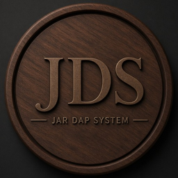

  

<h1 align="center">JDS · JAR DAP System</h1>

  Pacote de aplicativos para DAPs e celulares Android com foco em áudio de alta resolução. 
  <b>Otimizado para Android 9</b> (DAPs e LG com Quad DAC) e compatível com as versões mais novas.

  <a href="../../releases/latest"><b>⬇ Baixar a versão mais nova</b></a>

---

## O que vem no APK

Um único arquivo **JDS.apk** instala tudo. Na gaveta do celular aparece só o **JAR Music Player**; os outros apps abrem de dentro dele.

| App | Para que serve |
| --- | --- |
| **JAR Music Player** | Player Hi-Res: FLAC, ALAC, WAV, AIFF, MP3, AAC, CUE; saída para DAC USB na taxa original; letras, fotos de artistas e críticas |
| **EQ Full JAR** | Equalizador de 15 bandas e correções para fones (AutoEQ) |
| **Auttag** | Editor de tags e capas com busca na internet e análise de espectro |
| **Áudio Launcher** | Tela inicial de DAP com skins Madeira, Vinil, CD e Cassete |
| **JDS Streaming Home** | As músicas do seu computador no celular, em casa ou fora (Tailscale), com download das favoritas no Wi-Fi |

O **JDS Servidor** (Windows) é o programa que entrega as músicas do computador para o JDS Streaming Home.

## Como instalar

**Android**
1. Abra a [versão mais nova](../../releases/latest) e toque em **JDS.apk** para baixar.
2. Abra o arquivo baixado. Se o Android pedir, permita **instalar apps desconhecidos** para o navegador ou o gerenciador de arquivos.
3. Toque em **Instalar**. As próximas versões instalam por cima, sem perder músicas, favoritos ou ajustes.

**Windows (JDS Servidor)**
1. Na mesma página, baixe **JDS-Servidor-Setup.exe** e instale.
2. Abra o JDS Servidor, escolha a pasta de músicas e leia o QR code com o JDS Streaming Home.

## Apoie o projeto

O JDS é gratuito e sem anúncios. Se ele for útil para você, considere uma contribuição.

| PIX (R$ 5,00) | Bitcoin |
| :---: | :---: |
|  |  |
| Chave: `jonatanamancio@yahoo.com.br` Jonatan Amancio Ribeiro | `bc1q3xk9wulxvgwnngv2gakza2k4j69wpenk6xl8mj` |

No app, o botão **Apoiar o projeto JDS** (topo da biblioteca) mostra os mesmos dados, com botões de copiar.

## Segurança

Todos os APKs publicados aqui são assinados com a chave privada do projeto. Baixe o JDS somente desta página.

---

JDS · JAR DAP System — criador e integrador dos sistemas. Correções de fone: projeto AutoEQ (licença MIT).

